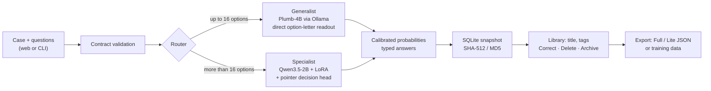
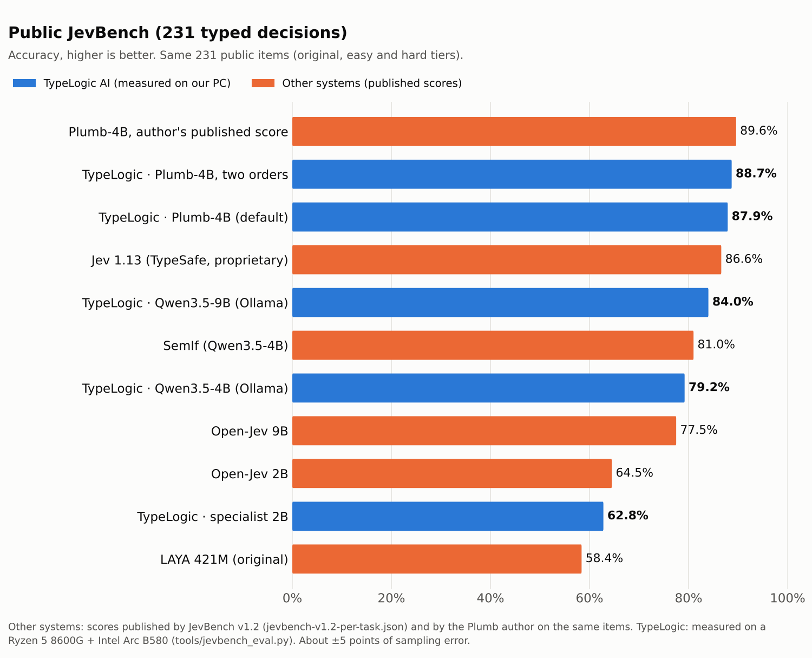
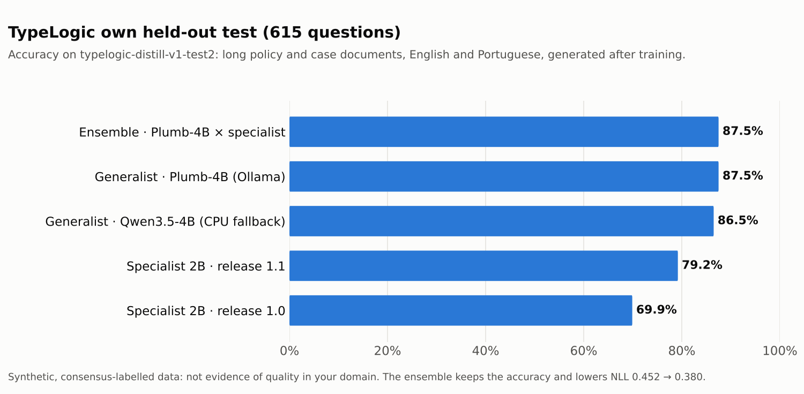
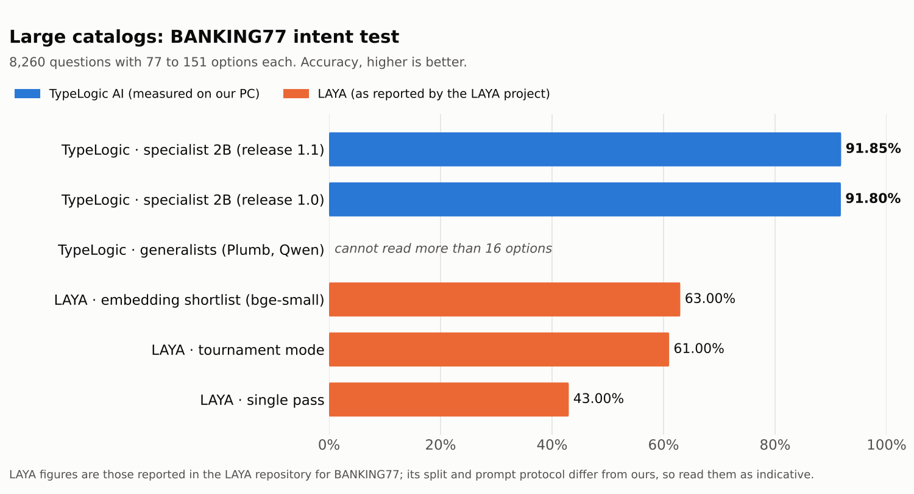
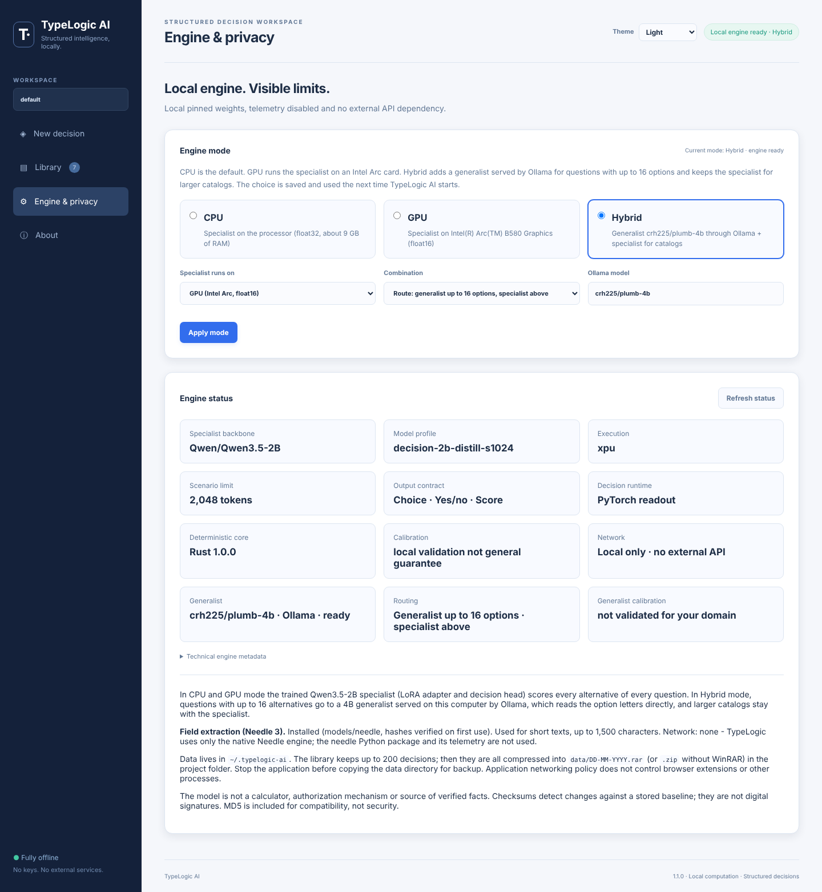

# TypeLogic AI

**Structured decisions. Controlled automation. Fully offline.**

[](LICENSE)


TypeLogic AI is an open-source, local decision engine for classification, scoring and routing. You describe a **case**, keep the facts that matter as typed **evidence**, and ask **Yes / no**, **Choice** or **Score** questions about it, in the same shape as Jev. It returns **typed answers with a probability for every alternative**: yes/no, one option of a choice, or a level on an ordered scale. Every decision is saved with a title and tags in a searchable Library; software reads the same results as JSON.

Everything runs on your computer: a loopback web interface, a command line, SQLite storage and local models. No account, API key, telemetry or cloud service.

<picture>
  <source media="(prefers-color-scheme: dark)" srcset="docs/screenshots/overview-dark.png">
  
</picture>

## Contents

- [Highlights](#highlights)
- [How it works](#how-it-works)
- [Benchmarks against other tools](#benchmarks-against-other-tools)
- [Models you need to download](#models-you-need-to-download)
- [Requirements](#requirements)
- [Installation](#installation)
- [Usage](#usage)
- [Engine modes: CPU, GPU, Hybrid](#engine-modes-cpu-gpu-hybrid)
- [Configuration](#configuration)
- [Project layout](#project-layout)
- [Tests and verification](#tests-and-verification)
- [Based on: projects, models and licenses](#based-on-projects-models-and-licenses)
- [License](#license)

## Highlights

- **Three answer types, as in Jev:** Yes / no, Choice (numbered options, each with when to choose it) and Score (numbered levels from lowest to highest), with a full probability distribution and an explicit "not enough information" option when you declare one.
- **Three engine modes, chosen in the web app:** CPU (default), GPU (Intel Arc) and Hybrid, where a 4B generalist reads up to 16 options directly and the trained Qwen3.5-2B specialist scores catalogs of any size (77 to 151 intents in one pass).
- **Accuracy on par with commercial engines:** 87.9% on the public JevBench items with the default generalist, above Jev 1.13 (86.6%) on the same items. See [benchmarks](#benchmarks-against-other-tools).
- **Case / Evidence / Decision:** the case is one text; templates add typed evidence fields (true/false, numbers, dates, text, enums) and the questions. A local LLM in Ollama (qwen3.5:4b by default) extracts the evidence from free text for you to confirm; it matched 92% of the values on 213 test documents. Needle 3 does the same for short texts. The evidence is an auditable record of the facts; it does not change model accuracy ([measurements](research/case-format-ab/README.md)).
- **Titles and tags:** give a case a title, or leave it empty and a short one is written after the evaluation (by the local Ollama model when it already runs, otherwise from the first sentence of the case). Tag it with suggested tags (billing, refund, fraud, security, support, logistics, urgent and more) or your own, with suggestions while you type.
- **Library:** every decision in a grid of 30 cards per page, filtered by the tags your decisions carry, ordered newest, oldest or lowest confidence first, with selection and bulk delete, corrections, and export of your corrections as training data. It keeps up to 200 decisions; then, after you confirm, all of them are compressed into `data/DD-MM-YYYY.rar` in the project folder (`.zip` when WinRAR is not installed) and the Library starts empty.
- **Integrity:** every decision has a unique ID and SHA-512/MD5 checksums verified on every read. Full and Lite JSON exports.
- **Needle 3** ([Cactus Compute](https://github.com/cactus-compute/needle), 121M parameters, 36 MB) as an offline evidence extractor for short texts. Only its native engine is used, with no telemetry and no network. See [docs/NEEDLE.md](docs/NEEDLE.md).
- **Deterministic core in Rust** (optional, with an identical Python fallback), bindings for Python, Node.js/TypeScript and Lua.

## How it works



- **Generalist** (`typelogic/direct.py`): an instruction-tuned model sees the state, the criterion and the lettered options in one message; one forward pass gives the probability of each answer letter. No text is generated. The default model is [Plumb-4B](https://ollama.com/crh225/plumb-4b), a Qwen3.5-4B tuned for exactly this readout, served by the local Ollama.
- **Specialist** (`typelogic/engine.py`): Qwen3.5-2B with a LoRA adapter and a pointer head that scores every alternative of a catalog in one pass. Trained by this project (profile `decision-2b-distill-s1024`).
- **Optional ensemble** (Hybrid option *Ensemble*): questions with up to 16 options are read by both engines and combined as a weighted product of probabilities. Same accuracy, better-calibrated probabilities, more memory and time.

In CPU and GPU mode the specialist answers every question; Hybrid mode adds the router shown above. Details: [docs/HYBRID-ENGINE.md](docs/HYBRID-ENGINE.md) and [docs/ARCHITECTURE.md](docs/ARCHITECTURE.md).

## Benchmarks against other tools

TypeLogic results were measured on one test machine (AMD Ryzen 5 8600G, 16 GB RAM, Intel Arc B580). Scores of the other systems are the ones they published for the same items. Raw results are in [`research/results`](research/results).

### Public JevBench (231 typed decisions)

<picture>
  <source media="(prefers-color-scheme: dark)" srcset="docs/images/jevbench-public-dark.png">
  
</picture>

<details>
<summary>Table</summary>

| System | Accuracy | Source |
|---|---|---|
| Plumb-4B (author's published score) | 89.6% | Plumb author |
| **TypeLogic · Plumb-4B, two option orders** | **88.7%** | measured |
| **TypeLogic · Plumb-4B (default generalist)** | **87.9%** | measured |
| Jev 1.13 (TypeSafe, proprietary) | 86.6% | JevBench v1.2 |
| TypeLogic · Qwen3.5-9B through Ollama | 84.0% | measured |
| SemIf (Qwen3.5-4B) | 81.0% | JevBench v1.2 |
| TypeLogic · Qwen3.5-4B through Ollama | 79.2% | measured |
| Open-Jev 9B | 77.5% | JevBench v1.2 |
| Open-Jev 2B | 64.5% | JevBench v1.2 |
| TypeLogic · specialist 2B | 62.8% | measured |
| LAYA 421M (original LAYA project) | 58.4% | JevBench v1.2 |

</details>

The public set has 231 items, so differences of a few points are within sampling error (about ±5 points). The 109 sealed JevBench items are not public, so these are not leaderboard scores.

### TypeLogic held-out test (615 questions)

<picture>
  <source media="(prefers-color-scheme: dark)" srcset="docs/images/typelogic-test2-dark.png">
  
</picture>

Long policy and case documents in English and Portuguese, generated after training and checked for overlap ([dataset card](research/data/typelogic-distill-v1-test2/README.md)). The ensemble keeps the accuracy and improves the probabilities: NLL 0.452 → 0.380, Brier 0.141 → 0.112, ECE 3.1%.

### Large catalogs: BANKING77 (8,260 questions, 77 to 151 options)

<picture>
  <source media="(prefers-color-scheme: dark)" srcset="docs/images/banking77-catalog-dark.png">
  
</picture>

LAYA figures are those reported by the LAYA repository; its split and prompt protocol differ from ours, so read them as indicative. This is why the hybrid engine keeps the specialist: generalists read at most 16 options per question.

> Synthetic and public test sets are not evidence of quality in your domain. Measure on labeled cases of your own before automating anything. Keep a person in charge of what the answers are used for.

## Models you need to download

The repository contains no model weights. Models 1 and 2 are needed in every mode; models 3 and 4 add the generalist of Hybrid mode; model 5 extracts evidence from case text; model 6 does it for short texts without Ollama. `TypeLogic.bat models` (or `./typelogic.sh models` on Linux) downloads all six and checks every file against SHA-256 hashes stored in this repository (Ollama checks its own models); `--only backbone|adapter|tokenizer|plumb|extractor|needle|weights-4b` runs one step.

| # | Model | Role | Size | License | Where it goes | How |
|---|---|---|---|---|---|---|
| 1 | [Qwen/Qwen3.5-2B](https://huggingface.co/Qwen/Qwen3.5-2B) at revision `15852e8c` | Specialist backbone | 4.6 GB | Apache-2.0 | `models/decision-2b-distill-s1024/backbone/` | `TypeLogic.bat models --only backbone` |
| 2 | **TypeLogic specialist adapter** `decision-2b-distill-s1024` (LoRA + decision head) | Specialist trained by this project | 88 MB | Apache-2.0 | `models/decision-2b-distill-s1024/adapter/` | Download `typelogic-adapter-decision-2b-distill-s1024.zip` from the [Releases page](../../releases), then `TypeLogic.bat models --only adapter --adapter-zip PATH` (found automatically in `Downloads`) |
| 3 | [crh225/plumb-4b](https://ollama.com/crh225/plumb-4b) (GGUF Q8_0) | Generalist (default) | 5.2 GB | Apache-2.0 | Ollama's model folder | `TypeLogic.bat models --only plumb` (or `ollama pull crh225/plumb-4b`) |
| 4 | [Qwen/Qwen3.5-4B](https://huggingface.co/Qwen/Qwen3.5-4B) tokenizer only, revision `851bf6e8` | Renders the generalist prompt | 20 MB | Apache-2.0 | `models/qwen35-4b/` | `TypeLogic.bat models --only tokenizer` |
| 5 | [qwen3.5:4b](https://ollama.com/library/qwen3.5) in Ollama | Evidence extraction from case text | 2.6 GB | Apache-2.0 | Ollama's model folder | `TypeLogic.bat models --only extractor` (or `ollama pull qwen3.5:4b`) |
| 6 | [Cactus-Compute/needle3](https://huggingface.co/Cactus-Compute/needle3) at revision `d6c7d6a2`: weights and the native engine for your platform | Evidence extraction for short texts | 36 MB | Apache-2.0 | `models/needle/` | `TypeLogic.bat models --only needle` |

Optional:

| Model | When | Size | How |
|---|---|---|---|
| Qwen/Qwen3.5-4B weights | Generalist on the CPU without Ollama (slower, 86.5% on the held-out test) | 9 GB | `TypeLogic.bat models --only weights-4b` |
| `qwen3.5:9b` or `qwen3.5:4b` in Ollama | Alternative generalists (calibration files included) | 6.6 / 2.6 GB | `ollama pull qwen3.5:9b`, then pick it as the Ollama model in Engine & privacy |
| `typelogic-training-data-v1.zip` (release asset) | Retraining the specialist only | 45 MB | Extract into the project folder |

With only models 1 and 2, use CPU or GPU mode. Hybrid mode without the specialist (only models 3 and 4) answers questions with up to 16 options; larger catalogs return an error.

## Requirements

| | Minimum | Tested |
|---|---|---|
| OS | Windows 10/11 64-bit or Linux x86-64 | Windows (full use), Ubuntu 24.04 (test suite and UI test) |
| CPU | x86-64 (AVX2 recommended) | AMD Ryzen 5 8600G |
| RAM | 16 GB | 16 GB |
| Disk | 15 GB free (models + Python packages) | |
| GPU | Not required. Ollama uses a supported GPU automatically; the specialist can run on Intel Arc (XPU) | Intel Arc B580 12 GB |
| Software | [Python 3.12](https://www.python.org/downloads/) 64-bit, [Ollama](https://ollama.com/download) for the generalist, a modern browser | Python 3.12, Ollama with Vulkan |
| Optional | [Rust](https://rustup.rs/) + Visual Studio Build Tools (native core), Node.js 18+ (web development, TypeScript SDK) | |

macOS is not tested: the pinned `torch==2.8.0+cpu` wheel does not exist there, so install `torch==2.8.0` manually.

## Installation

Everything goes through one launcher: **`TypeLogic.bat`** on Windows, **`./typelogic.sh`** on Linux. Double-click it (or run it without arguments) for a menu, or pass a command:

| Command | What it does |
|---|---|
| `TypeLogic.bat setup` | Creates the Python environment `.venv` and installs the pinned packages (PyTorch CPU build, about 1.5 GB) |
| `TypeLogic.bat setup --gpu` | Creates the Intel Arc environment `%USERPROFILE%\TypeLogic-XPU` (`torch==2.14.1+xpu`) for GPU mode |
| `TypeLogic.bat models [--only STEP]` | Downloads and verifies the models |
| `TypeLogic.bat start [--mode cpu\|gpu\|hybrid]` | Starts the web app; the mode is remembered |
| `TypeLogic.bat verify [--hybrid]` | Test suite, real decisions, readout parity and curated examples |
| `TypeLogic.bat cli <command>` | Command line (`decide`, `list`, `tags`, `delete`, `archive`, `export`, `training-export`, ...) |
| `TypeLogic.bat settings [key=value]` | Shows or changes the saved settings |
| `TypeLogic.bat diagnose` | Packages, model files, Python environments and Ollama |
| `TypeLogic.bat test` | Python test suite |
| `TypeLogic.bat evaluate [--data FILE] [--engine specialist\|generalist] [--limit N]` | Local evaluation on labeled cases: accuracy, NLL, Brier and ECE (menu option 12; default data: the held-out test set) |
| `TypeLogic.bat build-native` | Builds the optional Rust core (needs Rust) |

The launcher uses only the Python standard library, so it runs before the environment exists. One Ctrl+C stops the app (or a running command) and closes the launcher, without tracebacks or the "Terminate batch job" question. It starts the app in the environment that fits the mode: the CPU environment (`.venv`) or the GPU environment.

### Windows

1. **Install Python 3.12** from [python.org](https://www.python.org/downloads/) (tick "Add python.exe to PATH"). For Hybrid mode, also install **Ollama** from [ollama.com](https://ollama.com/download).
2. **Get the code:** `git clone https://github.com/marcusbsilva/TypeLogic-AI.git`, or download the ZIP from GitHub and extract it to a writable folder (not `Program Files`).
3. **Download the adapter** `typelogic-adapter-decision-2b-distill-s1024.zip` from the [Releases page](../../releases) into your `Downloads` folder (do not extract it).
4. Run **`TypeLogic.bat setup`**, then **`TypeLogic.bat models`**. Every downloaded file is verified; nothing is overwritten; run `models` again at any time and verified files are skipped. For Hybrid mode, Ollama must be open so the launcher can pull Plumb-4B.
5. Run **`TypeLogic.bat start`**. The browser opens `http://127.0.0.1:8765`; the engine loads in the background (badge *Local engine ready · CPU*).
6. Optional: `TypeLogic.bat verify --hybrid`.

Stop the app with Ctrl+C in its window.

**Intel Arc GPU:** install a current Intel Arc driver, run `TypeLogic.bat setup --gpu` once, then choose GPU in the web app or run `TypeLogic.bat start --mode gpu`. The specialist runs in float16 on the card (about 0.14 s per short question).

### Linux

```sh
git clone https://github.com/marcusbsilva/TypeLogic-AI.git
cd TypeLogic-AI
./typelogic.sh setup                       # .venv with Python 3.10+ (3.12 recommended)
curl -fsSL https://ollama.com/install.sh | sh    # only for Hybrid mode (see ollama.com)
./typelogic.sh models --adapter-zip ~/Downloads/typelogic-adapter-decision-2b-distill-s1024.zip
./typelogic.sh start --no-browser          # then open http://127.0.0.1:8765
```

The app only listens on the loopback address; on a server, reach it through an SSH tunnel. macOS is not tested: the pinned `torch==2.8.0+cpu` wheel does not exist there, so install `torch==2.8.0` in `.venv` manually.

### Native Rust core (optional)

The deterministic parts (validation, canonical JSON, checksums, router, decision-head readout) have a Rust implementation with results identical to the Python reference, which is used automatically when the native core is absent. Install Rust from [rustup.rs](https://rustup.rs/) (on Windows with the MSVC toolchain and Visual Studio Build Tools), then run `TypeLogic.bat build-native`.

### Updating

`git pull` (or download the new ZIP), run `TypeLogic.bat setup` again if `requirements.txt` changed, and `TypeLogic.bat models` if the release notes mention a new adapter. Your decisions and settings stay in `~/.typelogic-ai`; Library archives stay in the project's `data` folder.

## Usage

### Web app

1. **Case:** pick a template (14 built-in examples, plus the ones you save) or start from a blank case, and paste the original message, e-mail, tool call or scenario. Add a **title** (optional: without one, a short title is written after the evaluation) and **tags** (pick from the suggestions or type your own and press Enter; up to 8).
2. **Evidence:** the typed facts of the case. Type them, or click **Extract evidence** to have the local LLM (or Needle, for short texts) suggest them. Every extracted value is marked as extracted until you keep (✓) or correct it.
3. **Decisions:** for each one pick **Yes / no**, **Choice** or **Score** and write the question. Choice has numbered options (0, 1, 2, ...), each with when to choose it; Score has numbered levels from lowest to highest. The evidence is optional. Blocks 1 to 3 collapse and expand from their header; each block has a help icon.
4. Click **Evaluate decision**. The result shows the title, the tags and, for each question, every alternative with its probability. **Export Full JSON**, **Export Lite JSON** or **Delete** it.
5. Every decision is kept in the **Library**: filter it by tag, 30 cards per page, click a decision to open its answers (and **Back to Library** to return), record a correction, or select several to delete them. When the Library holds 200 decisions, the next evaluation asks to archive them all into the project's `data` folder first.

"Save as template" stores the current layout in `templates/custom/` (to share) and in your data folder. The format is described in [templates/README.md](templates/README.md).

<picture>
  
</picture>

### Command line

```bat
TypeLogic.bat cli examples
TypeLogic.bat cli decide --input examples\business\billing.json --format lite --output decision-lite.json
TypeLogic.bat cli decide --mode hybrid --input examples\business\billing.json
TypeLogic.bat cli decide --input request.json --title "Failed payout" --tag billing --tag urgent
TypeLogic.bat cli list --tag billing
TypeLogic.bat cli tags
TypeLogic.bat cli export --id DECISION_ID --format full --output record.json
TypeLogic.bat cli training-export --output corrections.jsonl
TypeLogic.bat cli templates --id execution-safety > request.json
TypeLogic.bat cli extract --input email.txt --template ticket-routing
TypeLogic.bat cli delete --id DECISION_ID
TypeLogic.bat cli archive --yes
```

On Linux use `./typelogic.sh cli <command>`. A request is a JSON object in the Case / Evidence / Decision format:

```json
{
  "title": "Failed payout",
  "tags": ["billing", "urgent"],
  "case": "My payout has failed three days in a row and support chat keeps timing out. I need this fixed today.",
  "evidence": {"payment_related": true, "payout_failed_days": 3, "urgency": "high"},
  "decisions": [
    {"output": "choice", "instructions": "Which team should handle this message?",
     "criteria": {"0": "Billing: payments, payouts, invoices, refunds", "1": "Technical: bugs, outages, integrations, API errors",
                  "2": "Sales: pricing, upgrades, new accounts", "3": "Not enough information"},
     "abstain_option": "3"},
    {"output": "boolean", "instructions": "Does the customer need an answer today?"}
  ]
}
```

Questions need no name: they are answered as `decision_1`, `decision_2`, ... in order. The web app numbers Choice options 0, 1, 2, ...; requests from your own software may use any option names. Each answer has a `confidence` (its top probability, as in Jev). `title` and `tags` are optional: the response returns the title (yours, or a generated one, with `title_source`) and the normalized tags (lowercase, up to 8). When the Library already holds 200 decisions, `POST /api/evaluate` answers 409 with code `library_full`; archive the Library (`cli archive --yes` or `POST /api/archive` with `{"confirm": true}`) to continue.

The Jev format, a state with named questions, is also accepted (with optional `title` and `tags`):

```json
{
  "title": "Billing · duplicate payment",
  "state": "The customer paid twice for one order and asks for the duplicate payment to be refunded.",
  "questions": {
    "team":   {"type": "choice", "instructions": "Which team should handle this request?",
               "criteria": {"A": "Billing", "B": "IT support", "X": "Not enough information"}, "abstain_option": "X"},
    "refund": {"type": "noul",   "instructions": "Does the customer ask for a refund?"},
    "urgency":{"type": "score",  "instructions": "How urgent is this request?",
               "criteria": ["Low: no deadline", "High: blocked service or deadline today"]}
  }
}
```

The [user guide](docs/GUIDE.md) covers every option: indicators, titles and tags, the Library and its archive, Full and Lite JSON, integrity, the CLI, calibration and retraining with your corrections.

### Integrating with other software

- **HTTP:** the web app's local API (`POST /api/evaluate` and others, session-token protected, loopback only). The TypeScript SDK in [`sdk/typescript`](sdk/typescript) has a typed client.
- **CLI:** `cli decide --input - --jsonl` reads one request per line from stdin.
- **Rust core:** Node.js (N-API) and Lua 5.4 modules in `sdk/` for validation, checksums and the router without Python.

## Engine modes: CPU, GPU, Hybrid

TypeLogic starts on the **CPU** by default. Change the mode on the **Engine & privacy** page of the web app, with `TypeLogic.bat start --mode ...`, or with `--mode` on `cli decide`. The choice is saved in `~/.typelogic-ai/settings.json` and used the next time.

| Mode | Engine | Needs | Memory |
|---|---|---|---|
| **CPU** (default) | Specialist on the processor, float32 | Models 1 and 2 | about 9 GB of RAM |
| **GPU** | Specialist on an Intel Arc GPU, float16 | Models 1 and 2, `TypeLogic.bat setup --gpu` | about 4.5 GB of VRAM |
| **Hybrid** | Generalist (Plumb-4B through Ollama) for up to 16 options + specialist for larger catalogs | Models 1 to 4, Ollama | 5.2 GB in Ollama (GPU when available) + 4.5 GB for the specialist (CPU bfloat16 or GPU) |

Hybrid options on the same page: where the specialist runs (CPU or GPU), the combination (*Route* by number of options, or *Ensemble*: both engines for up to 16 options, better probabilities, slower) and the Ollama model. The app starts the local Ollama server by itself when it is closed (it never downloads anything).

Switching to GPU mode from the web app when the app runs in the CPU environment: the app saves the choice and exits, the launcher restarts it in the GPU environment, and the page reloads by itself. Without the launcher (`python -m typelogic`), start the app from the GPU environment instead.

<picture>
  <source media="(prefers-color-scheme: dark)" srcset="docs/screenshots/engine-mode-dark.png">
  
</picture>

## Configuration

`TypeLogic.bat settings` shows the settings; `TypeLogic.bat settings key=value` changes them (`mode`, `hybrid_device`, `hybrid_combine`, `ollama_model`, `ollama_models` for a custom Ollama model folder, `gpu_python` for a GPU environment in another folder). Environment variables override them for one run:

| Variable | Default | Effect |
|---|---|---|
| `TYPELOGIC_MODE` | saved mode, else `cpu` | `cpu`, `gpu` or `hybrid` |
| `TYPELOGIC_OLLAMA_MODEL` | `crh225/plumb-4b` | Ollama model of the generalist |
| `TYPELOGIC_HYBRID_MODE` | saved option, else `route` | `ensemble` combines both engines for up to 16 options |
| `TYPELOGIC_ENSEMBLE_WEIGHT` | `0.55` | Generalist weight in the ensemble |
| `TYPELOGIC_DIRECT_ORDERS` | `1` | `2` reads each question in two option orders (+0.8 to +1.4 points, twice the time) |
| `TYPELOGIC_GENERALIST_FALLBACK` | CPU fallback when weights exist | `none` disables the Qwen3.5-4B CPU fallback when Ollama is down |
| `TYPELOGIC_CPU_PRECISION` | `float32` (`bfloat16` in Hybrid) | Specialist precision on the CPU |
| `TYPELOGIC_READOUT` | `onnx` | Decision-head backend on the CPU: `onnx`, `rust` or `torch` (parity-checked) |
| `TYPELOGIC_MODEL_DIR` | `models/active.json` | Specialist profile folder |
| `TYPELOGIC_NEEDLE_DIR` | `models/needle` | Folder with the Needle weights, engine and manifest |
| `TYPELOGIC_RAR` | WinRAR found in PATH or `Program Files\WinRAR` | Path of `Rar.exe` used to archive the Library (without it the archive is a `.zip`) |
| `OLLAMA_MODELS` | Ollama default | Ollama model folder used when the app starts the Ollama server |

Saved settings (`TypeLogic.bat settings key=value`, or the web app): `extract_backend` (`auto`, `ollama` or `needle`), `extract_model` (default `qwen3.5:4b`), plus the engine mode settings above.

## Project layout

| Path | Contents |
|---|---|
| `launcher/` | The launcher behind `TypeLogic.bat` and `typelogic.sh` (standard library only) |
| `typelogic/` | Application: contract, engines (`engine.py`, `direct.py`, `hybrid.py`, `modes.py`), server, store, CLI, compiled web UI |
| `web/` | TypeScript sources of the web UI and its end-to-end test |
| `tools/` | Model download, evaluation, calibration, training and dataset tools |
| `models/` | Profile metadata, calibration and manifests (weights are downloaded here) |
| `research/` | Datasets, benchmark results and the dataset-generation pipeline ([README](research/README.md)) |
| `rust/`, `sdk/` | Rust core and its Python, Node.js, Lua bindings and SDKs |
| `templates/` | Decision templates: `builtin/` (shipped) and `custom/` (saved from the app, to share) |
| `examples/` | Fictional business scenarios in the original request format (CLI and tests) |
| `docs/` | Guides, architecture, verification and research notes |
| `tests/` | Python test suite |

The root holds only the launchers (`TypeLogic.bat`, `typelogic.sh`), the documentation and the project files; the launcher itself is `launcher/launcher.py`.

## Tests and verification

```sh
TypeLogic.bat test                         # Python suite (model tests skip when weights are absent)
TypeLogic.bat verify --hybrid              # tests + real decisions with every readout and the hybrid engine
node web/tests/ui.test.mjs                 # browser test of the web UI (needs Playwright)
```

`MODEL-PARITY.json` freezes the files that define how the trained specialist reads a decision; `tests/test_model_parity_freeze.py` fails if any of them changes. Evidence of past verification runs: [docs/VERIFICATION.md](docs/VERIFICATION.md).

## Based on: projects, models and licenses

TypeLogic AI is an independent project. It reuses code, ideas, models and data from the projects below, each under its own license. Source headers, [`NOTICE`](NOTICE) and [`licenses/`](licenses) keep the original notices. No endorsement by any of these projects is implied.

### Code adapted into this repository

| Project | Author | License | What TypeLogic uses | Where |
|---|---|---|---|---|
| [kev](https://github.com/jaredpalmer/kev) @ `fe64b127` | Jared Palmer | Apache-2.0 | Pointer decision model, block-causal branch mask and prefix cache: the specialist's architecture | `typelogic/vendor/pointer.py` |
| [SemIf](https://github.com/TheoLeeCJ/SemIf) (formerly OpenJev) | TheoLeeCJ | MIT | Direct option-letter readout and the mapping of typed questions to lettered options: the generalist | `typelogic/direct.py` |
| [Open-Jev](https://github.com/kyegomez/open-jev) @ `93843ef2` | Kye Gomez | Apache-2.0 | Structured state encoding and research objective | `typelogic/vendor/structured.py` |
| [Needle](https://github.com/cactus-compute/needle) @ `b4fc11b0` | Cactus Compute | Apache-2.0 | `ctypes` signatures of the native engine (the Python package itself, with its telemetry and network code, is not used) | `typelogic/needle.py` |

### Projects that shaped the design (no code copied)

| Project | License | Influence |
|---|---|---|
| [LAYA](https://github.com/NandhaKishorM/laya) (original) | Apache-2.0 | The original typed-decision engine (ModernBERT, 421M). TypeLogic started as a local, extended LAYA: same idea of typed questions over a state, plus longer contexts, catalogs above 20 options, calibration and review. Used as a benchmark reference. |
| Jev 1.13 by TypeSafe | Proprietary | The "System One" typed-decision model and request format (state, questions, `choice` / `noul` / `score`). A small sample was used as a teacher for dataset labels (see `research/`). |
| reflex (kshetrajna12) | see its repository | Idea of averaging two option orders (`TYPELOGIC_DIRECT_ORDERS=2`). |
| Imajev-4B (mohit67890), JevK5 (allebee), Plumb (crh225) | Apache-2.0 | Distillation practices: teacher consensus, soft labels, replay of human-labeled data, hard-question mining. |
| [Entendendo o Hype do Jev](https://akitaonrails.com/2026/10/03/entendendo-o-hype-do-jev-pra-que-serve/) (article) | n/a | Engineering guidance. |

### Models

| Model | Author | License | Use |
|---|---|---|---|
| [Qwen3.5-2B](https://huggingface.co/Qwen/Qwen3.5-2B) | Alibaba Qwen | Apache-2.0 | Specialist backbone (downloaded) |
| TypeLogic adapter `decision-2b-distill-s1024` | this project | Apache-2.0 | Specialist LoRA and decision head (release asset) |
| [Plumb-4B](https://ollama.com/crh225/plumb-4b) | crh225 | Apache-2.0 | Default generalist (through Ollama) |
| [Qwen3.5-4B](https://huggingface.co/Qwen/Qwen3.5-4B) | Alibaba Qwen | Apache-2.0 | Generalist tokenizer; optional CPU generalist |
| [Qwen3.5-4B](https://ollama.com/library/qwen3.5) (`qwen3.5:4b` in Ollama) | Alibaba Qwen | Apache-2.0 | Evidence extraction (through Ollama) |
| [Needle 3](https://huggingface.co/Cactus-Compute/needle3) (weights and native engine 3.3.3) | Cactus Compute | Apache-2.0 | Evidence extraction for short texts (downloaded) |

### Data

| Dataset | License | Use |
|---|---|---|
| [JevBench](https://github.com/fstandhartinger/jevbench) public items @ `609a664e` | MIT | Benchmark (`research/data/jevbench-public`) |
| [BANKING77](https://github.com/PolyAI-LDN/task-specific-datasets) (PolyAI) | CC BY 4.0 | Catalog training and test |
| [CLINC150](https://github.com/clinc/oos-eval) (Larson et al.) | CC BY 3.0 | Intent data import and decontamination |
| `typelogic-distill-v1` and `-test2` | Apache-2.0, see dataset cards | Synthetic typed decisions generated and labeled with third-party models through OpenRouter; check each provider's terms before redistributing the texts |

### Runtime dependencies

| Package | License |
|---|---|
| [PyTorch](https://pytorch.org) | BSD-3-Clause |
| [Transformers](https://github.com/huggingface/transformers), [PEFT](https://github.com/huggingface/peft), [safetensors](https://github.com/huggingface/safetensors), [huggingface_hub](https://github.com/huggingface/huggingface_hub) | Apache-2.0 |
| [NumPy](https://numpy.org) | BSD-3-Clause |
| [ONNX](https://onnx.ai) | Apache-2.0 |
| [ONNX Runtime](https://onnxruntime.ai) | MIT |
| [pytest](https://pytest.org) | MIT |
| [Ollama](https://github.com/ollama/ollama) (separate program) | MIT |
| [PyO3](https://github.com/PyO3/pyo3) and the other Rust crates in `rust/Cargo.lock` | MIT / Apache-2.0 |
| [TypeScript](https://www.typescriptlang.org), [esbuild](https://esbuild.github.io), [Playwright](https://playwright.dev) (development only) | Apache-2.0 / MIT / Apache-2.0 |

## License

TypeLogic AI is open source under the [Apache License 2.0](LICENSE). Third-party components keep their own licenses (see above, [`NOTICE`](NOTICE) and [`licenses/`](licenses)).

TypeLogic AI estimates probabilities; it does not make decisions for you. Results can be wrong, especially outside the domains it was tested on. Keep a human in the loop and measure quality on your own labeled cases before relying on any automation.
