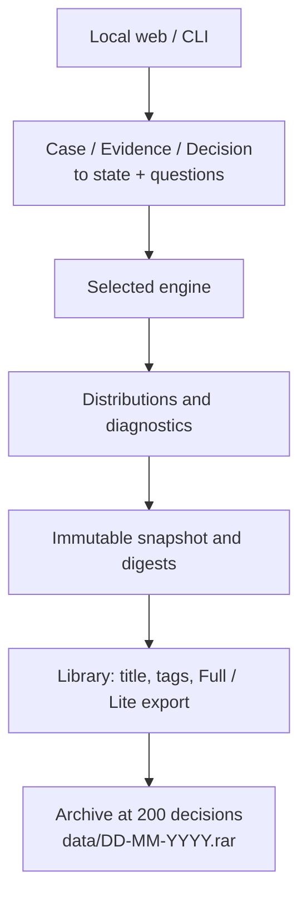

# Architecture — TypeLogic AI

A local decision intelligence application with a loopback web interface and an offline CLI. Both share validation, evaluation and SQLite storage. No external API, first-run download or business action is performed.

## Responsibilities

| Module | Responsibility |
| --- | --- |
| `schema.py` | Validate scenarios/questions; normalize finite distributions; produce typed answers and human question metadata. |
| `modes.py` | Engine modes CPU, GPU and Hybrid: settings in `<data>/settings.json`, availability checks and engine construction. |
| `ollama.py` | Probe and start the local Ollama server (loopback only, never downloads) and unload its models. |
| `hybrid.py` | Route each question to the generalist (at most 16 options) or the specialist; optional ensemble (weighted product of probabilities). |
| `direct.py` | Generalist: direct option-letter readout through Ollama, llama.cpp or PyTorch, with per-backend calibration and optional two-order averaging. |
| `engine.py` | Load local pretrained weights, bound prefix cache, evaluate independent questions and test option permutations. |
| `onnx_head.py` | Export the head with the effective temperature and check numerical parity before ONNX inference. |
| `specialist.py` | Verify local graph hashes and run a fixed question profile entirely in ONNX CPU. |
| `casefmt.py` | Case / Evidence / Decision requests: one case text, typed evidence, unnamed Jev-style decisions (answered as `decision_1`, ...); conversion to state + questions, evidence flags, title and tag validation (`TAGS`: the suggested tags). |
| `templates.py` | Decision templates from `templates/builtin`, `templates/custom` and `<data>/templates`; saving writes the project and data copies. |
| `evidence.py` | Evidence extraction by schema: local Ollama with JSON-schema output (context sized to the text, never truncated) or Needle for short texts; every value unverified with an evidence check. |
| `needle.py` | Optional field extraction: load the native Needle 3 engine and weights after SHA-256 verification, fill declared fields, check each value against the text. Never imports the `cactus-needle` package. |
| `titles.py` | Short case titles generated after the evaluation when none was typed: an Ollama model that is already running and pulled (Hybrid generalist, then the extraction model), else the first sentence of the case. |
| `archive.py` | Library limit (200 decisions over all workspaces) and the archive: one JSON file per decision plus a SHA-256 manifest, compressed with WinRAR's `Rar.exe` into `<project>/data/DD-MM-YYYY.rar` (or `.zip`), tested before the decisions are removed. |
| `exports.py` | Canonical immutable snapshots, SHA-512/MD5 comparison and the minimal typed Lite contract. |
| `store.py` | SQLite snapshots, corrections (feedback), audits, deletion and integrity migration (including dropping the status column of earlier databases). |
| `server.py` | Orchestrate requests, titles, tags, the library limit and persistence; serve loopback UI with session token, Host/Origin checks and body limits. |
| `cli.py` | JSON/stdin/stdout operations with diagnostics on stderr; only `serve` starts HTTP. |
| `examples.py` | Share the eleven fictional scenarios with UI and CLI. |
| `web/` | English presentation, complete questions, answers, checked digests, anchored explanations and local themes. |

## Models

`model_profile.py` pins the specialist backbone (Qwen/Qwen3.5-2B, revision `15852e8c`, 2048-dimensional hidden states) and its asset hashes; `profiles.py` resolves the active profile from `models/active.json`. The backbone and the trained LoRA/pointer head are separate assets downloaded by `tools/fetch_models.py` and verified against `manifest.json`; runtime refuses missing or mismatched files and never downloads. Calibration is bound to the checkpoint fingerprint. `MODEL-PARITY.json` freezes the files that define the specialist's encoding.

The generalist (`direct.py`) needs the Qwen3.5-4B tokenizer in `models/qwen35-4b` to render prompts, and reads probabilities from the local Ollama server (default `crh225/plumb-4b`) or from Qwen3.5-4B weights in PyTorch. Its calibration files are bound to backend, model tag and option-order setting. Teacher APIs are isolated in explicit research commands.

## Engines and contracts

The engine mode (`modes.py`) selects the engine: CPU and GPU run the specialist alone; Hybrid builds both engines. The web app switches modes at runtime (`POST /api/mode`): it builds the new engine, releases the old one and, when GPU mode needs the GPU Python environment, saves the choice and exits with code 75 so the launcher (`launcher/launcher.py`) restarts it there. The router sends questions with more than 16 options to the specialist and the others to the generalist; each answer records its `engine`. The specialist loads lazily on the first catalog question to save memory. The specialist's decision head can be read by ONNX Runtime, Rust or PyTorch, with parity checked at load. The optional fixed-profile specialist (`specialist.py`) uses a hashing encoder and an ONNX readout trained for a closed set of questions. Synthetic examples validate the workflow, not production accuracy.

Web startup loads once in the background; status and errors remain visible, and premature evaluation is refused. CLI loading is synchronous only for `decide`. Queries, deletion, archiving, verification and exports do not need model weights.

The bounded cache preserves equivalent responses. Context exceeding limits is refused without truncation. Each question is evaluated independently. Calibration is bound to effective weight/configuration fingerprints. Temperature changes distributions; the request threshold only marks candidates in the technical response. Answers remain ineligible for automation (`eligible_for_automation: false`).

Confidence is `100 × max(p)`. Concentration is `100 × (max(p) − 1/n)/(1 − 1/n)`. Score is `Σ i × p(i)`. Human Score answers and Lite show the modal level; Full retains the expected numeric score and distribution. Help explains actual values and formulas, not internal reasoning or factual validation. Its floating, escaped tooltip supports hover, click, focus and Escape without moving content.

## Identity, integrity and migration

SQLite decision columns are the immutable `id`, `space`, `title`, `request`, `response`, `created`, plus `sha512`, `md5`, `baseline_origin`. Tags live in the request (`request.tags`); the title is set before the record is stored, so both are covered by the digests. New evaluations create a UUID-based ID and a baseline digest pair in the creation transaction.

`typelogic-record-v1` hashes an object containing exactly `id`, `space`, `title`, `created`, `request`, `response`. JSON keys are sorted, separators compact, encoding UTF-8 and non-finite numbers refused. The response excludes the envelope's self-referential integrity metadata. Creation time and ID bind otherwise identical evaluations to different records.

Reading recomputes and compares both digests. A failed check prevents corrections and single-record Full/Lite export. Listing, whole-workspace export and archives preserve failure flags for inspection; deletion remains available. Corrections are stored separately, so they do not change the fingerprint.

An older seven-column database receives columns and an explicit `migrated_existing` baseline once. Databases from versions with review statuses drop their discarded rows and then the `status` column (SQLite 3.35 or later; older SQLite keeps the column filled with a constant); the status was never hashed, so records stay verified. This does not establish pre-upgrade authenticity. Reopening does not re-seal changed rows or missing digests. Existing user content and IDs are retained, without translation.

Checksums are not signatures or secret keys. MD5 is compatibility-only. An attacker who can alter both SQLite data and baseline values can evade the check. Record fingerprints do not authenticate requests or authorize execution. Security decisions require independent deterministic server checks.

## Library, exports, deletion and archive

Evaluation stores the decision with its title and tags and a creation audit. A correction saves an observed distribution without automatic training. Delete removes decision, corrections and audit rows in one transaction (`POST /api/delete` with `id` or `ids`); repeated deletion reports that no record remained. This is logical removal, not certified secure media erasure.

The Library holds at most 200 decisions over all workspaces. `POST /api/evaluate` refuses a new decision with 409 `library_full` before the engine runs; the web app asks first and then calls `POST /api/archive` with `{"confirm": true}`. The archive is written in a temporary folder inside `<project>/data`, compressed (`rar a -r -ep1 -m5`, then `rar t`; or a tested ZIP), and only then are the archived rows deleted in one transaction. A failure leaves the Library unchanged. CLI lists and exports include all remaining records. Independent backups, archives and downloaded files are unaffected by decision deletion.

Single-decision exports read verified storage, never a stale UI copy. Full returns the stored record and integrity report. Lite contains exactly `{title, tags, questions:[{question, answer}]}` with Choice IDs, binary booleans or the most probable Score level label. Bulk Lite uses a `decisions` wrapper; Full workspace export includes corrections and audit. `decide`'s default Full evaluation envelope is retained for integration compatibility; `export --id` retrieves the full stored scenario.

## Interface and offline policy

`web/theme.js` applies Light/Dark/System before CSS and stores preference locally; System follows OS changes. SVG help icons align with adjacent text. Template selection immediately fills the case, evidence and decisions. The decision editor follows Jev: Yes / no, Choice and Score tabs and no decision names. Blocks 1-3 of New decision collapse; blocks 1-4 have help icons. The tag field suggests the suggested tags and the tags already used while typing and accepts any other tag. Dynamic user content is escaped. No remote assets are loaded.

Case text and evidence are data, not authorization. Workspaces are operator groupings, not multi-user isolation.

Weights are local. The generalist talks only to the Ollama server on the loopback address. Needle field extraction runs in-process through its native engine, which has no network code; extracted values reach the engine only when the operator attaches them, as `model_extracted_fields`, and are flagged on every answer. ONNX telemetry is disabled before import/session creation. Python external sockets are blocked while loopback is allowed. The kernel-level Linux inference test can deny all subprocess sockets. The policy does not control browser extensions or other processes. Optimized GPU kernels (`flash-linear-attention`, `causal_conv1d`) are not installed; the reference implementations are correct but slower.

## Presentation

`exports.export_filename` maps ID plus format to five SHA-256 bytes, encoded as eight lowercase Base32 characters. The browser implements the same algorithm with Web Crypto. The basename is a convenient label, not a unique identity guarantee or integrity check.

Choice probability rows display IDs plus full criteria. The example selector retains native keyboard interaction while a wrapping text label prevents clipping. The Library lists decisions in a grid of 30 cards per page, filtered by the tags in use, with a detail view.

## Presentation contracts

The form request preview and Evaluate share `buildCaseRequest()`. Preview/copy only serialize local form values and create no persisted records. Engine-profile cards read actual health metadata; upstream context sizes, hosted latency and provider benchmarks are never substituted for installed capabilities.

