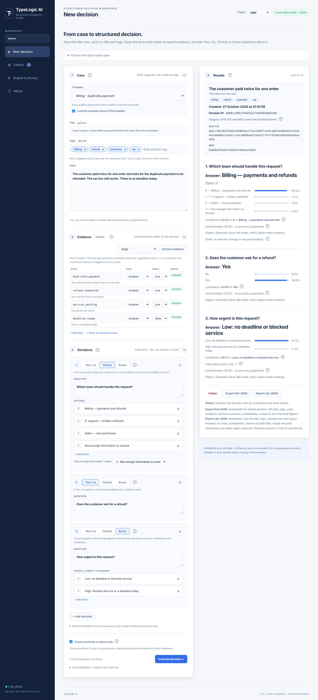
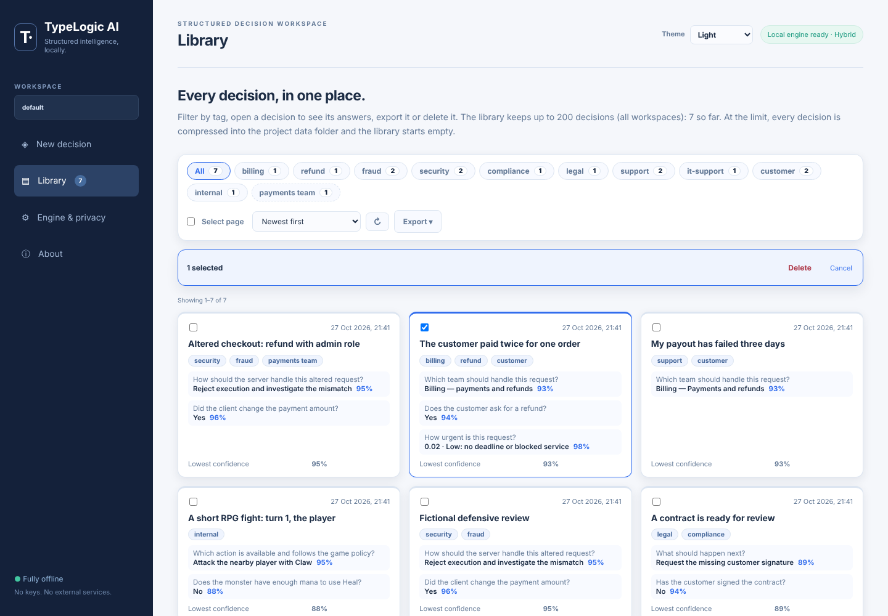

# TypeLogic AI user guide

This guide covers the web interface, the command line, exports, evaluation and retraining. Installation is in the [README](../README.md).

Everyday commands go through the launcher (`TypeLogic.bat` on Windows, `./typelogic.sh` on Linux). In the research commands below, `python` means the interpreter of your TypeLogic environment: `.venv\Scripts\python.exe` on Windows (created by `TypeLogic.bat setup`), `.venv/bin/python` on Linux, or `%USERPROFILE%\TypeLogic-XPU\Scripts\python.exe` for Intel Arc (created by `TypeLogic.bat setup --gpu`).

## 1. Web workflow

Start the app with `TypeLogic.bat start` (or `./typelogic.sh start`). The browser opens `http://127.0.0.1:8765`; the engine loads in the background while you type. The engine mode (CPU by default, GPU or Hybrid) is chosen on the **Engine & privacy** page, see [section 8](#8-engine-modes).

A decision has three parts:

| Part | Answers | In the app |
|---|---|---|
| **Case** | What happened? | One text: the original message, e-mail, tool call or scenario, kept for audit, with an optional title and tags |
| **Evidence** | Which facts matter? | Typed fields: `boolean`, `number`, `integer`, `date`, `text`, `enum` |
| **Decisions** | What must be decided? | Questions in the Jev style, each Yes / no, Choice or Score |

The steps:

1. **Case.** Pick a template, or start from a blank case.
   - The 14 built-in templates come with fictional example values and suggested tags. Untick *Load the example values* to start empty.
   - **Title** (optional): a short name for the decision in the Library. Leave it empty and a title is written after the evaluation: by the local Ollama model when Ollama is already running with that model pulled (in Hybrid mode the generalist, otherwise the extraction model, `qwen3.5:4b` by default), otherwise from the first sentence of the case, cut to eight words. Ollama is never started or asked to download anything for a title.
   - **Tags** (optional, up to 8): type in the tag field; suggestions appear as you type, from the suggested tags (billing, refund, fraud, security, compliance, legal, support, technical, sales, purchasing, logistics, inventory, hr, finance, it-support, urgent, low-priority, escalation, customer, internal) and the tags already used in your Library. Enter, Tab or a comma adds the highlighted suggestion or your own text; Backspace on an empty field removes the last tag. Tags are stored in lowercase.
   - Paste the case text.
2. **Evidence** (optional; open it to add fields). Type the values, or click **Extract evidence**.
   - **Choosing the extractor:**
     - **Auto** uses the local LLM in Ollama (`qwen3.5:4b` by default) when it is installed, otherwise Needle.
     - **Needle** reads short texts only (up to 1,500 characters).
   - **Marking:** extracted values are marked *extracted*, with the check *written in the case*, *not found in the case*, *inferred* (true/false and enums) or *not stated*.
   - **Confirming:** keep each value (✓, or *Keep all*) or correct it. An unconfirmed value is flagged on every answer (`unconfirmed_evidence`).
3. **Decisions.** Each decision is one question, with no name. Pick the type, in this order:
   - **Yes / no:** just the question. The answer is the probability that it is true; the case and the evidence carry the facts.
   - **Choice:** the question and the options, numbered 0, 1, 2, ... like Score levels; the number is the value the answer returns, and each option says when to choose it. *"Not enough information" option* marks the option that means abstention.
   - **Score:** the question and the levels, numbered from lowest to highest. The score is the expected level, from 0.
   - The circled (!) next to the type buttons explains them.
4. **Evaluate decision.** The result starts with the title (marked *Title taken from the case* or *Title written by* the model when it was generated), the tags, the creation time, the decision ID and the integrity check. Each answer shows the full question, the **Answer:**, every alternative with its probability, the **confidence** (the top probability, as in Jev), the concentration and which engine answered (generalist, specialist or ensemble).
5. **Export Full JSON**, **Export Lite JSON** or **Delete** the decision. It is already saved in the [Library](#2-library).

Blocks 1 (Case), 2 (Evidence) and 3 (Decisions) collapse and expand when you click their header; a problem found in a collapsed block opens it. Every block, including 4 (Results), has a circled (!) with an explanation.



Choice answers show the declared option ID and its description. Yes/no answers show Yes or No. Score answers show the most probable level and, separately, the expected index. Dates use the browser time zone. Theme: Light, Dark or System, remembered by the browser.

### What the engine reads

By default the engine reads the case as plain text: the case as written, then one `name: value` line per evidence field, in name order. A request can set `"engine_input": "json"` to send one canonical JSON object instead. Provenance (template, typed, extracted, confirmed) stays in the stored request for audit.

On the 615 held-out questions, neither the case layout nor the evidence changed accuracy with the current models: every difference was within ±1 point and inside the 95% interval of zero. The JSON rendering cost the specialist 1.3 to 1.6 points (also not significant) and more tokens, which is why plain text is the default. Evidence *without* the case text lost 12 to 22 points, so keep the full case. The value of evidence today is an auditable record of the facts; unconfirmed or missing required evidence is flagged on every answer. The local LLM extracted about 92% of the values correctly. Measurements: [research/case-format-ab](../research/case-format-ab/README.md).

### Templates

Templates hold suggested tags, the evidence schema, the decisions and optional example values.

**Save as template** writes the current layout to `templates/custom/<id>.json` in the project folder (to share, for example with git) and to `~/.typelogic-ai/templates/`. Built-in templates cannot be replaced.

`TypeLogic.bat cli templates` lists all templates. `cli templates --id ID` prints a template as a ready-to-edit request. The format is in [templates/README.md](../templates/README.md).

### Case options

| Option | Purpose and usage |
| --- | --- |
| Check sensitivity to option order | Reads each Choice decision again with the options reversed and rotated, maps the probabilities back and flags a changed winner or a shift above 0.15. Adds time; two stable orders do not prove robustness. |

The circled `!` icons open explanations on hover, click or keyboard focus; Escape closes them.

### Output types

Open **Choose the right output type** in the app to compare them.

| Type | Answer | Write it like this |
| --- | --- | --- |
| Yes / no | `true` or `false`, with the yes-probability | One explicit proposition, with when it is true and when it is false. Separate a current request from a hypothetical, negated or quoted one. |
| Choice | One declared option (its number in the app) | A clear description for every option; add a "not enough information" option and mark it when that is a valid outcome. |
| Score | One ordered level and the expected level | Describe every level, from lowest to highest. The expected level starts at zero; it is not an objective measurement. |

### Indicators

For normalized probabilities `p` over `n` alternatives:

- **Confidence:** `100 × max(p)` with the most probable alternative (`confidence` in the JSON, as in Jev). A model estimate, not an observed success rate.
- **Concentration:** `100 × (max(p) − 1/n) / (1 − 1/n)`. 0% is a uniform distribution, 100% puts all mass on one alternative. Not a correctness guarantee.
- **Calculated score:** `Σ i × p(i)` with zero-based level indices. It can be fractional and can differ from the most probable level.

A selected abstention, a sensitive option order and unconfirmed or missing evidence are noted under the answer.

### Actions

| Action | Effect |
| --- | --- |
| Delete | Removes the decision, its corrections and audit entries in one transaction. Files already exported, archives and backups are not affected. |
| Record correction | Saves the observed answer for one question. Nothing is retrained automatically. |
| Export Full JSON | The stored decision with ID, title, tags, case, evidence, decisions, technical response and checked digests. |
| Export Lite JSON | Only the title, the tags, the questions and the typed answers. |
| Export training data | Corrections of this workspace as JSON Lines for retraining (section 6). |
| Export Full Workspace JSON | All workspaces, decisions, feedback and audit records, with integrity flags. |

## 2. Library

**Library** lists every decision of the workspace as a grid of cards, 30 per page. Each card shows the time, the title, the tags, the first answers with their confidence and the lowest confidence of the decision. The counter next to *Library* in the menu is the number of decisions.

- **Tag filter:** *All* plus one chip for every tag your decisions carry, each with its count: the suggested tags first, then your own tags (dashed outline) by frequency, and *Untagged* when some decisions have no tag. The filter grows as you tag decisions; past 14 tags, *+N more* shows the rest.
- **Pages:** *Showing 1–30 of N* above the grid and **‹ Previous**, page numbers and **Next ›** below it.
- **Order:** Newest first, Oldest first, or Lowest confidence first (the lowest model probability first; the model's own estimate, not a measured accuracy).
- **Open a decision:** click a card to see its title, tags, identity, integrity check and every answer, with **Delete**, **Record correction** and the Full and Lite exports. **Back to Library** (or Escape) returns to the grid.
- **Several at once:** tick cards, or **Select page**. A bar appears with **Delete** and **Cancel**.
- **Export ▾:** training data (corrections as JSON Lines) and the full workspace JSON.

### Library limit and archive

The Library keeps up to **200 decisions**, counted over all workspaces; New decision shows how many are stored. When it is full, **Evaluate decision** first opens a dialog: every decision will be compressed into one file in the `data` folder of the TypeLogic AI project, named after the day (`DD-MM-YYYY.rar`, then `DD-MM-YYYY-2.rar` on the same day), and removed from the Library. **Archive and continue** writes the archive, tests it, removes the decisions and then evaluates; **Cancel** evaluates nothing.

- The archive holds `decisions/<workspace>/<id>.json` (the full stored record with its integrity check, corrections and audit trail) and `manifest.json` (app version, date, count, workspaces and the SHA-256 of every file).
- RAR needs WinRAR's command-line tool `Rar.exe` (found in `PATH`, in `Program Files\WinRAR`, or set with `TYPELOGIC_RAR`; `rar` on Linux). Without it the archive is a `.zip` with the same content, and the dialog says so.
- Nothing is removed when writing or testing the archive fails.
- From the command line: `TypeLogic.bat cli archive` shows what would happen; `cli archive --yes` archives. Through the API, `POST /api/evaluate` answers 409 with code `library_full` when the Library is full, and `POST /api/archive` with `{"confirm": true}` archives.



### Full and Lite JSON

Single-decision exports are verified when they are read. A failed integrity check blocks corrections and single exports; it does not block deletion. A workspace export keeps flagged records for inspection.

Lite has exactly three top-level fields and two fields per question:

```json
{
  "title": "Duplicate charge on order 1182",
  "tags": ["billing", "refund"],
  "questions": [
    {"question": "Which department should review the request?", "answer": "A"},
    {"question": "Is the customer requesting a refund?", "answer": true},
    {"question": "How urgent is the request?", "answer": "Normal"}
  ]
}
```

Choice answers are option IDs, Yes/no answers are booleans and Score answers are the most probable level label. Use Full JSON for probabilities, the expected index and level legends. Editing the form after an evaluation does not change the stored snapshot.

Web downloads of one decision are named with eight Base32 characters derived from the first 40 bits of SHA-256 of `decision_id:format`, plus `.json`. Short names are not guaranteed to be globally unique; the full decision ID is authoritative.

### Identity and integrity

Each evaluation gets a UUID-based ID. SHA-512 and MD5 are recorded at creation and recomputed on every read, over the immutable snapshot (`id`, `space`, `title`, `created`, `request`, `response`) serialized with sorted keys, compact separators, UTF-8 and finite numbers. Corrections are stored separately, so recording one does not change the digests. Databases from versions with review statuses lose the status column on first open; the digests never covered it, so those records stay verified.

These are **checksums, not secret keys or digital signatures**. MD5 is there for compatibility and has known collision weaknesses. Someone who can change both a record and its stored digest can bypass the check. Website authorization needs server-side identity, permissions, trusted amounts and replay protection, independent of any model.

## 3. Examples

All examples are fictional and editable (`examples/business/`). `examples/business-validation.jsonl` holds expected answers for a sanity check (`python tools/check_examples.py --output example-check.json`). Curated examples are not a measure of production accuracy.

| ID | Scenario |
| --- | --- |
| `billing` | Duplicate charge, department routing and refund request. |
| `it-support` | Route a login failure and check whether sign-in succeeded. |
| `purchasing` | Route a supplier quote and check its stated total. |
| `expenses` | Expense reimbursement and missing evidence. |
| `inventory` | Confirmed empty stock and an explicit replenishment policy. |
| `sales` | Route a product demonstration request and identify its intent. |
| `documents` | Request a missing contract signature. |
| `logistics` | Delivery issue and escalation. |
| `insufficient-evidence` | Explicit abstention when facts are inadequate. |
| `rpg-combat` | A short RPG fight: health, distance, mana and a blocked retreat leave one usable attack. No game action is executed. |
| `request-integrity` | Review a request altered by the client: changed amount and action and a client-supplied role. |

## 4. Command line

The web app and the CLI share `~/.typelogic-ai/typelogic.sqlite3`. `--data` picks another folder and `--space` a workspace. JSON goes to stdout, diagnostics to stderr, and output files are never overwritten.

```bat
TypeLogic.bat cli examples
TypeLogic.bat cli examples --id rpg-combat
TypeLogic.bat cli decide --input examples\business\billing.json --output decision-full.json
TypeLogic.bat cli decide --input examples\business\request-integrity.json --format lite --output decision-lite.json
TypeLogic.bat cli decide --input request.json --title "Failed payout" --tag billing --tag urgent
TypeLogic.bat cli list --tag billing
TypeLogic.bat cli tags
TypeLogic.bat cli feedback --id DECISION_ID --question q1 --target "{\"A\": 1, \"X\": 0}"
TypeLogic.bat cli delete --id DECISION_ID
TypeLogic.bat cli export --id DECISION_ID --format full --output record-full.json
TypeLogic.bat cli export --id DECISION_ID --format lite --output-dir exports
TypeLogic.bat cli verify --id DECISION_ID
TypeLogic.bat cli training-export --output corrections.jsonl
TypeLogic.bat cli templates
TypeLogic.bat cli templates --id execution-safety > request.json
TypeLogic.bat cli extract --input email.txt --template ticket-routing
TypeLogic.bat cli extract --input email.txt --schema schema.json --backend needle
TypeLogic.bat cli archive
TypeLogic.bat cli archive --yes
TypeLogic.bat cli profiles
TypeLogic.bat cli status
```

On Linux, replace `TypeLogic.bat cli` with `./typelogic.sh cli`. `decide` accepts `--mode cpu|gpu|hybrid` for one run. `verify` exits with code 1 when the check fails. `--input -` reads stdin and `--jsonl` evaluates one request per line. `decide` reads both request formats: Case / Evidence / Decision (v2) and scenario + questions (v1). `extract` suggests evidence for a text file or the case of a request, with the schema of a template (`--template`) or your own (`--schema`), through the local LLM or Needle (`--backend auto|ollama|needle`). `decide --title` sets the title and `--tag` (repeatable) adds tags to the request's own. `list --tag` keeps the decisions with that tag; `tags` lists the suggested tags and the tags in use with their counts. `delete` removes one decision with its corrections and audit records. `archive` reports the Library count and the archive name; `archive --yes` compresses every decision into the project's `data` folder and removes them. Query, delete, archive and export commands do not load the model or start HTTP. Run any command with `--help`.

## 5. Workspaces

Workspaces group decisions; they are not security boundaries between users. Stop the app before copying its data folder for a backup.

## 6. Evaluation, calibration and retraining

### Measure

The simplest way is the launcher: menu option **12 · Local evaluation on labeled cases**, or

```bat
TypeLogic.bat evaluate
TypeLogic.bat evaluate --engine generalist --limit 100
TypeLogic.bat evaluate --data my-labeled-cases.jsonl --engine specialist
```

It asks for (or takes) a labeled JSONL file, the engine and an optional limit, runs `tools/eval_split.py` and saves the report in `~/.typelogic-ai/evaluations/`. The default data is the held-out test set (615 questions). Without `--engine` it uses the generalist in Hybrid mode and the specialist otherwise (on the GPU in GPU mode). The tools underneath:

```bat
python tools\eval_split.py --split research\data\typelogic-distill-v1-test2\test.jsonl --system direct --model-dir models\qwen35-4b --ollama-model crh225/plumb-4b --out results\plumb-test2.json
python tools\eval_split.py --split research\data\typelogic-distill-v1-test2\test.jsonl --system typelogic --out results\specialist-test2.json
python tools\jevbench_eval.py --system direct --model-dir models\qwen35-4b --ollama-model crh225/plumb-4b --out results\jevbench-plumb
python tools\benchmark.py --data your-test.jsonl --out benchmark.json
```

Labeled JSONL rows use `state`, `questions`, `targets` and an optional `group_id`. Keep related cases (same customer, same document, same period) in one split, and never tune thresholds or temperature on the final test.

### Calibrate

The specialist temperature is fitted with `tools/calibrate.py` and applied with `tools/apply_calibration.py`; it is bound to the weights fingerprint, so a different checkpoint ignores it. The generalist uses `tools/calibrate_direct.py`, one file per backend and model in `models/qwen35-4b/direct-calibration-*.json`. `--apply` needs at least 50 calibration and 20 validation records and an improvement without degrading validation. This gate does not certify quality in your domain.

### Retrain the specialist with your corrections

1. Record corrections in the Library (open a decision, **Record correction**). Aim for 100 to 200 corrected decisions. Archive files keep corrections too, but only decisions still in the Library are exported.
2. Export them: **Export training data**, or `TypeLogic.bat cli training-export --all-spaces --output research\data\feedback-2026-11.jsonl`. A correction becomes the target of its question. Decisions about the same scenario share one `group_id`.
3. Download `typelogic-training-data-v1.zip` from the GitHub release and extract it into the project folder (it fills `research/data/intent-choice-en-v2/` and `research/data/jev-banking77-catalog-v2-audited/`).
4. Build a new mix. One in ten feedback scenarios goes to validation; none goes to calibration or test:

```bat
python tools\build_training_mix.py --distill research\data\typelogic-distill-v1 --replay-train research\data\jev-banking77-catalog-v2-audited\train.jsonl --replay-splits research\data\intent-choice-en-v2 --tokenizer models\decision-2b-distill-s1024\backbone --max-state 1024 --feedback research\data\feedback-2026-11.jsonl --out research\data\typelogic-mix-v2
```

5. Train from the current adapter on a GPU (`tools/train_colab_v2.py --init-from models\decision-2b-distill-s1024 ...`, see [TRAINING-INTEL-ARC.md](TRAINING-INTEL-ARC.md)), then calibrate, evaluate on the test sets and install the run as a new profile. Read [MODEL-PARITY-ANALYSIS.md](MODEL-PARITY-ANALYSIS.md) first: the encoder files are frozen by `MODEL-PARITY.json`.

### Small custom specialist (ONNX)

`tools/train_specialist.py` trains a tiny fixed-profile specialist that runs entirely in ONNX on the CPU, for a closed set of questions:

```bat
python tools\train_specialist.py --train examples\specialist-train.jsonl --validation examples\specialist-validation.jsonl --out models\custom-profile --steps 100
python tools\run_app.py --specialist models\custom-profile
```

The bundled demo data is synthetic and tiny; it shows the workflow, not production quality.

## 7. Privacy and limits

- The app binds to `127.0.0.1`, requires a per-session token and checks Host and Origin. Python sockets to non-loopback addresses are blocked while the app runs; ONNX Runtime and Hugging Face telemetry are disabled. This does not control browser extensions or other programs.
- The Ollama generalist runs in the separate Ollama process on the loopback address; `TYPELOGIC_OLLAMA_URL` can change the port but must point to this computer.
- Evidence extraction runs on this computer: the local Ollama (loopback only) or Needle's native engine, verified against `models/needle/manifest.json`. The `cactus-needle` Python package, which sends usage telemetry and contacts Hugging Face, is never used.
- Weights are loaded only from local folders and checked against SHA-256 manifests; there is no download at startup.
- Probabilities are estimates, conditional on the options you declared. High probability is not proof. Measure on labeled cases from your own domain before trusting any automation.
- Deletion is logical database deletion, not certified erasure of disks or backups. Library archives in the project's `data` folder are ordinary unencrypted files; delete or move them yourself when they are no longer needed. There is no application-level disk encryption.

## 8. Engine modes

| Mode | What runs | When to use it |
|---|---|---|
| **CPU** (default) | The trained specialist on the processor (float32) | Any computer with 16 GB of RAM; catalogs of any size |
| **GPU** | The specialist on an Intel Arc GPU (float16) | Faster answers when the GPU environment is installed (`TypeLogic.bat setup --gpu`) |
| **Hybrid** | A generalist through Ollama (Plumb-4B) for questions with up to 16 options, and the specialist for larger catalogs | Best accuracy on rules, policies and multi-step judgments (87.9% on the public JevBench) |

Change the mode on the **Engine & privacy** page: pick CPU, GPU or Hybrid, set the Hybrid options (specialist on CPU or GPU, *Route* or *Ensemble*, Ollama model) and choose **Apply mode**. The new engine loads in the background and the old one is released. A mode that this computer cannot run is shown as unavailable, with the reason (for example a missing GPU environment or Ollama model).

When the app runs in the CPU environment and you choose GPU, it saves the choice and exits; the launcher restarts it in the GPU environment and the page reloads by itself. The same choice is available as `TypeLogic.bat start --mode gpu|cpu|hybrid` (saved for the next start), `TypeLogic.bat settings mode=hybrid`, `--mode` on `cli decide`, or the `TYPELOGIC_MODE` environment variable for one run.
